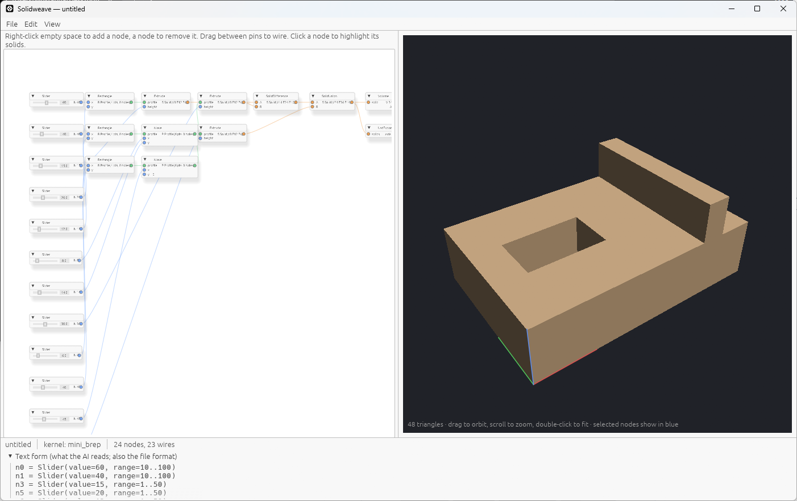
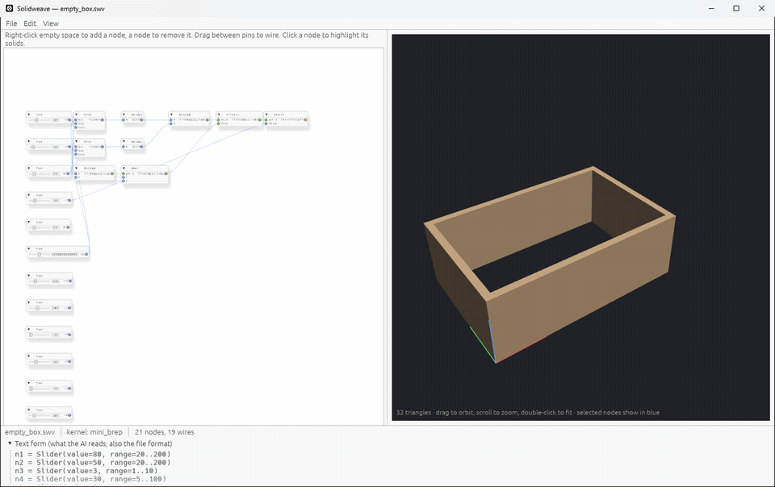

# Solidweave

Solidweave is an original parametric CAD system in Rust, built to be driven
by AI, with native support for NVIDIA's OpenUSD B-rep (BrepArray) format. A
node graph weaves profiles, extrusions, revolutions and booleans into solids;
every edit goes through one command API that a person, a script or an AI can
use.



*The machined-block example: sliders drive two rectangles extruded into a
block and a slot cutter, a boolean difference, and a union with a rib.*



*An open box with four mounting holes, edited from outside the editor: each
change rewrites the open `.swv` file, as the MCP tools do, and the editor
reloads it.*

| Crate | What it is |
|---|---|
| `mini_brep` | B-rep kernel: planes, cylinders, cones, spheres, tori; extrude, revolve, and booleans of planar solids; through-holes; exact volume and area; validation. |
| `node_graph` | Grasshopper-style dataflow graph. Every edit goes through one command API, which is also the AI's interface; `Graph::check` reports what the graph makes and what is wrong. |
| `usd_brep` | Reads, writes and validates BrepArray `.usda` files. |
| `cad_app` | Desktop editor (egui): node canvas, live 3D preview, AI assistant, save/open, undo/redo, export to `.usda` and `.stl`, examples. |

Only `cad_app` has external dependencies (eframe/egui, egui-snarl, rfd, and
ureq and serde_json for the AI assistant); the other three use the standard
library alone.

Saved graphs (`.swv`) are plain text in the same form the AI reads, for
example:

```
n0 = Slider(value=60, range=10..100)
n2 = Rectangle(x=n0.N, y=n1.N)          # @ 230,0
n4 = Extrude(profile=n2.R, height=n3.N)
n13 = SolidDifference(A=n4.S, B=n12.S)
```

## Getting started

Install Rust (https://rustup.rs), then:

```
cargo run -p cad_app        # the editor; opens on the machined-block example
cargo test --workspace      # every test
```

File → Examples has two more parts. Drag a slider and the part updates.

To use the AI assistant, set `ANTHROPIC_API_KEY` to your Anthropic API key
before starting the editor, then describe a part or a change in the panel on
the right. The AI edits the graph with the same commands as the canvas; it
never edits geometry. After it finishes, the graph is evaluated and every
solid checked against NVIDIA's BrepArray rules, and any problems go back to
it to fix. Its whole turn is one undo step. This is an early feature: it has
been tested with recorded replies, not yet measured on many real prompts.

### From Claude Code (or any MCP client)

`solidweave-mcp` is an MCP server with the same tools, plus `open`,
`export` and `guide`. In this repository Claude Code finds it through
`.mcp.json`; elsewhere, register it with
`claude mcp add solidweave -- cargo run -q -p cad_app --bin solidweave-mcp`
(run from the repository). Ask for a part saved to a `.swv` file, and open
that file in the editor: it reloads on every change, so you can watch the
part being built and adjust the sliders yourself.

See `00_PROJECT_OVERVIEW.md` for the architecture, verified results and
roadmap.

## Relationship to NVIDIA

This is original work, **compatible with** NVIDIA's OpenUSD B-rep schema
and checked against NVIDIA's own tools. It is not affiliated with or
endorsed by NVIDIA.

- **File format:** `usd_brep` implements NVIDIA's BrepArray schema exactly,
  so files work in NVIDIA's tools. The Rust code is written from the schema.
- **Validator:** modelled on NVIDIA's `brep_validator.py` (same checks and
  `BA_xxx` codes), reimplemented in Rust. It agrees with NVIDIA's validator on
  132 of 132 of NVIDIA's sample files.
- **Kernel, graph and editor:** our own designs. Our exported solids load
  into NVIDIA's SMLib kernel as valid solids with matching volumes and pass
  SMLib's full geometry checks (17 of 17), and our booleans give the same
  results as SMLib's (6 of 6). That is how we check correctness. No SMLib
  code is included.

Future features ported from NVIDIA's code follow one rule: their code is the
specification and the reference to test against, and the Rust version is
designed from scratch. See `NOTICE` for attribution under Apache-2.0.

## License

Licensed under either of

- Apache License, Version 2.0 ([LICENSE-APACHE](LICENSE-APACHE))
- MIT license ([LICENSE-MIT](LICENSE-MIT))

at your option. Unless you explicitly state otherwise, any contribution you
submit for inclusion in this project, as defined in the Apache-2.0 license,
shall be dual licensed as above, without any additional terms or conditions.

The NVIDIA test files in `usd_brep/tests/fixtures/` stay under NVIDIA's
Apache-2.0 licence (see the `NOTICE.md` there), and `NOTICE` lists everything
that derives from NVIDIA's usd-brep and from csg.js.
